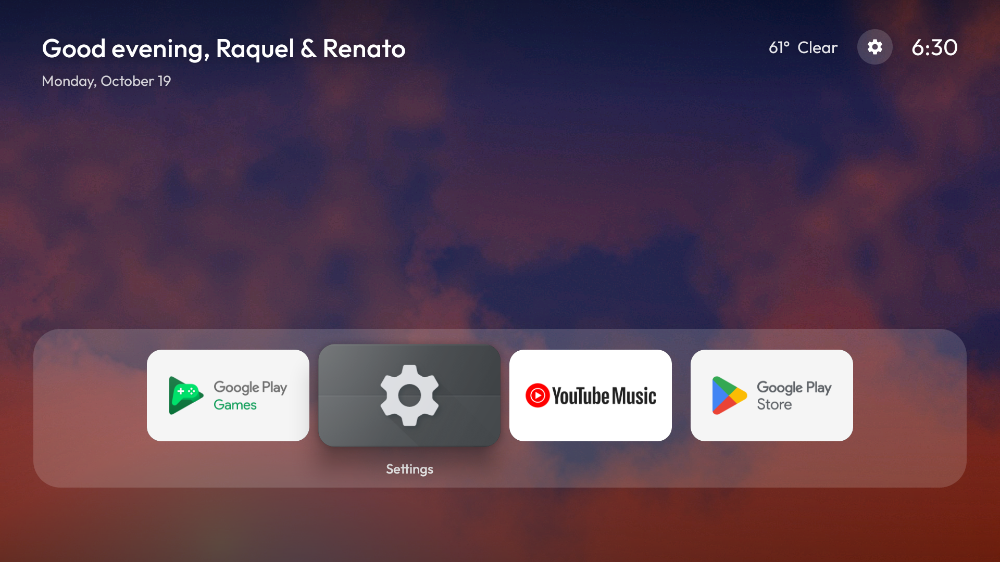
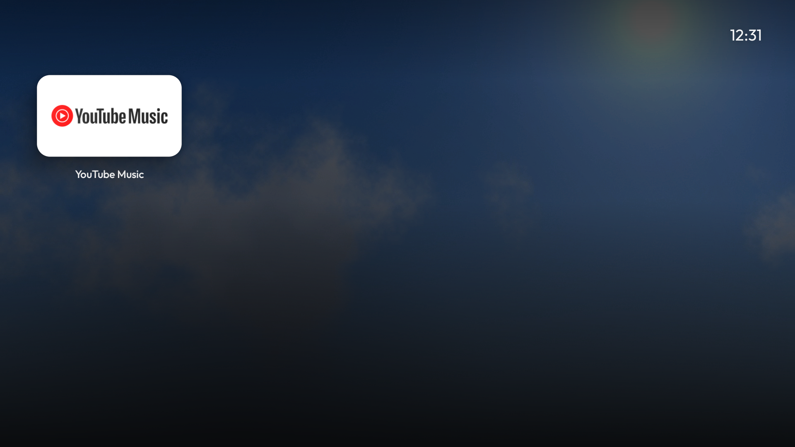

# shroom

A clean, ad-free home screen for Android TV / Google TV, plus the scripts to install it and debloat
the TV safely. No root, nothing flashed, nothing uninstalled, and one command puts the TV back exactly
how it was.

Built on the approach of [Gathin23/cleanyourtv](https://github.com/Gathin23/cleanyourtv) (MIT): its
ADB tooling and hard-won TV quirks are reused here; the launcher itself is a new design.

## What it looks like



Laid out like Apple TV:

- **A red sunset sky** behind everything.
- **Top left:** "Good morning / afternoon / evening / night, Raquel & Renato" and the date.
- **Top right:** the weather in °C, a settings button (press Up from the apps), and a 24-hour clock.
- **The Top Row** of your favourite apps sits centred in a frosted band, with Google Play Store
  included. The selected app lifts toward you with a spring, a soft shadow and a light sheen, and its
  name appears underneath.
- **Every other app is underneath.** Press Down and the whole screen glides up and the sky dims.
  Up, Back or Home brings it back.
- **Hold OK** on an app for Move (it jiggles; use Left/Right, then OK), Add to / Remove from Top Row,
  App Info. The **settings button** (or Menu on the remote) has Screensaver, TV Settings and
  Choose Home App.
- **Inputs** (HDMI, AV, Live TV) shows up as a tile at the end of the grid on TVs that have them.
- A drifting **clock screensaver** (OLED-safe): TV Settings > Screensaver > "Shroom clock".
- No ads and no analytics. The only thing that goes online is the weather: Open-Meteo (free, no
  account), with an approximate location from geojs.io unless you set a city. About 220 KB.



## What you do on the TV (once)

1. **Settings > Device Preferences > About** (or System > About) > press OK on **Build** 7 times
   until it says you're a developer.
2. Back > **Developer options** > turn on **USB debugging**. If you see **Network debugging** or
   **ADB debugging**, turn that on too.
3. Note the TV's IP: **Settings > Network & Internet > (your Wi-Fi)**.
4. Keep the TV on. The first time the PC connects, the TV asks **"Allow USB debugging?"**: tick
   **Always allow from this computer** and press OK.

## What runs on the PC

Everything is PowerShell from the repo folder (first time only: `tools\setup.ps1`).

```powershell
powershell -ExecutionPolicy Bypass -File tools\connect.ps1 -TvHost 192.168.1.50   # check the connection
powershell -ExecutionPolicy Bypass -File tools\backup.ps1                         # snapshot (install also does it)
powershell -ExecutionPolicy Bypass -File tools\install.ps1                        # build + install + make it Home
```

`install.ps1` first just *asks* Android to use Shroom as Home. Many Android TV sets accept that and
nothing else changes. If Home still goes to the stock launcher (normal on Google TV), it stops and
tells you; then:

```powershell
powershell -ExecutionPolicy Bypass -File tools\install.ps1 -SkipBuild -DisableStock
```

That disables (never uninstalls) the stock launcher. If Home then lands anywhere but Shroom, the
script switches everything back on by itself. On Google TV the setup wizard can grab Home; add
`-AlsoDisable com.google.android.tungsten.setupwraith` in that case.

Change the names in the greeting, or pin the weather to a city instead of the automatic location:

```powershell
tools\venv\Scripts\python.exe -I tools\tv.py "am start -n app.shroom.tv/.MainActivity --es names 'Raquel & Renato' --es city Lisbon"
```

To grab a screenshot of whatever the TV shows (saved in `screenshots\`):

```powershell
powershell -ExecutionPolicy Bypass -File tools\screenshot.ps1
```

## Debloating (optional, after the launcher works)

Ads and tracking on most TVs come from manufacturer packages. `debloat\examples\` has tested lists
for about 30 models. The safe order:

1. Start from your model's list, or have Claude build one from `pm list packages` on your TV.
2. Review it. Keep anything you use. Never disable: Play Store, Play Services, the keyboard, the TV
   input / HDMI / tuner services, remote and Bluetooth pairing.
3. Apply in small batches and check the TV between them:
   `powershell -ExecutionPolicy Bypass -File tools\debloat.ps1 debloat\my-tv.txt`

## Going back

**From the PC (restores everything):**

```powershell
powershell -ExecutionPolicy Bypass -File tools\restore.ps1              # stock launcher back, all packages re-enabled
powershell -ExecutionPolicy Bypass -File tools\restore.ps1 -Uninstall   # ...and remove Shroom
```

`restore.ps1` compares the TV against the **first** backup in `backups\`: every package disabled since
then is re-enabled, and Home goes back to the launcher it was. It doesn't depend on remembering which
script disabled what. Keep the `backups\` folder (it stays on this PC and is not pushed to GitHub).

**From the TV alone (no PC):**

- In Shroom, press **Menu** > **Choose Home App** (works while the stock launcher is still enabled).
- Menu > TV Settings > Apps > *See all apps / Show system apps* > **Google TV Home** (or
  **Android TV Home**) > **Enable**, then press Home.
- Anything disabled by debloating can be switched back on from the same place.

**Worst case**, a factory reset from the TV's Settings re-enables everything. Nothing here touches the
system partition, so nothing survives a reset.

## Troubleshooting

- **Connection times out**: the TV went to sleep, the IP changed, or the "Allow USB debugging" prompt
  is waiting on screen. Some Google TV sets only open port 5555 after pairing once via
  *Wireless debugging* with Android's own `adb` (platform-tools): `adb pair`, `adb connect`,
  `adb tcpip 5555`.
- **Google TV keeps going to its own home**: run install with `-DisableStock`, and if needed
  `-AlsoDisable com.google.android.tungsten.setupwraith`. Restore re-enables both. Re-enable the setup
  wizard before any factory reset.
- **The remote's YouTube / Netflix buttons stop working** after the stock launcher is disabled on
  Google TV: see `debloat\examples\google-chromecast-gtv-4k\debloat.txt` for the Key Mapper fix.
- **Switch USB debugging off when you're done.** Shroom keeps working; you only need it again to
  update or restore.
- **Updating Shroom** later: run `install.ps1` again. Builds are signed with this PC's Android debug
  key (`%USERPROFILE%\.android\debug.keystore`); keep that file, or uninstall first when building
  from another PC.

## Building

`tools\build.ps1` needs JDK 17 (`winget install Microsoft.OpenJDK.17`) and the Android SDK with
platform 34 and build-tools 34 in `%LOCALAPPDATA%\Android\Sdk`. The sky is generated, not a photo:
`tools\wallpapers.py` repaints it.

The launcher is plain Java with no libraries (`launcher\app\src\main\java\app\shroom\tv`):

| File | What it does |
|---|---|
| `MainActivity.java` | Header, Top Row, app grid, the glide between them, menus, rearranging, inputs |
| `Weather.java` | Current weather from Open-Meteo, in °C |
| `Tile.java` | The app card: lift, shadow, sheen, name on focus, jiggle |
| `Backdrop.java` | Sky, colour glow, scrims, page dimming (one view, no blur) |
| `Apps.java` | Installed TV apps and the Top Row order (stored on the TV) |
| `Ui.java` | 960x540 layout grid, Outfit font weights, colour sampling |
| `ClockDream.java` | Screensaver |

## Licence

MIT, see [LICENSE](LICENSE). `tools/tv.py`, `tools/b64push.py` and `debloat/examples/` come from
cleanyourtv (MIT, Gathin). Outfit typeface: SIL Open Font License, `launcher/FONT-LICENSE-OFL.txt`.
